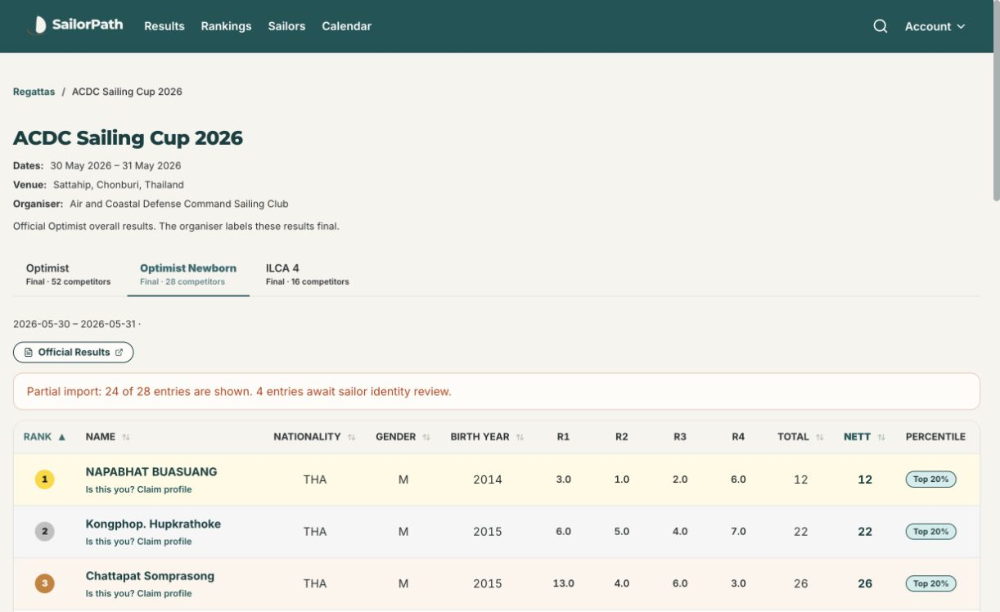

# Sail-Result 2026 results import

**Updated 22 October 2026:** Per user instruction, all five Optimist Newborn sheets were removed (129 entries/816 scores), along with 36 Newborn-only profiles. The held DOH VINNA result is now attached to Markus Doh Vinna (+1 entry/12 scores). Subsequent identity confirmations attached two Henry results, one Jiahe result and one separate Natidej result. Current batch: **40 sheets, 744 entries, 5,433 race scores across 14 events; 11 entries awaiting identity review.** [Identity update](../identity-resolutions-20261022/report.md). The original import inventory below is retained as historical evidence. [Cleanup report](../newborn-removal-20261022/report.md).

Production data import completed on 22 October 2026 (Singapore time).

**45 published class/fleet sheets across 14 parent events: 868 result entries, 868 participant links and 6,203 individual race scores. Zero inventory or score reconciliation exceptions. 24 ambiguous entries deferred at the user’s request.**

Ten parent events and 166 profiles were created. Four existing parent events were reused and their class lists extended. Existing sailor profiles and existing result sheets were preserved. No birth dates were invented; no Singapore ranking credit was assigned.

## Imported inventory

| Event | Classes and imported/official entries |
|---|---|
| [2026 Optimist Asian & Oceanian Championship – Thailand Team Selection Trials](https://sailorpath.com/regattas/optimist-asian-oceanian-thailand-selection-trials-2026) | Optimist Open: 25/25 |
| [Ranong Regatta Sailing Championship 2026](https://sailorpath.com/regattas/ranong-regatta-sailing-championship-2026) | Optimist Newborn: 26/27; Optimist Open: 32/34 |
| [Boat Club 88 Sailing Regatta 2026](https://sailorpath.com/regattas/boat-club-88-sailing-regatta-2026) | Optimist Newborn: 10/10; Optimist Open: 24/24; ILCA 6 : 3/3; ILCA 4 : 4/4 |
| [ACDC Cup International Sailing Championship 2026](https://sailorpath.com/regattas/acdc-cup-international-sailing-championship-2026) | Optimist Newborn: 42/45; ILCA 7 : 7/7; ILCA 6 : 7/8; ILCA 4 : 23/25 |
| [EGAT and YRAT Regatta 2026](https://sailorpath.com/regattas/egat-and-yrat-regatta-2026) | Optimist Open: 46/48; ILCA 6 : 10/10; ILCA 4 : 8/10 |
| [Pattaya Regatta 2026](https://sailorpath.com/regattas/pattaya-regatta-2026) | Optimist Open: 17/17; ILCA 7 : 6/6; ILCA 6 : 5/5; ILCA 4 : 10/10 |
| [ACDC Sailing Cup 2026](https://sailorpath.com/regattas/acdc-sailing-cup-2026) | Optimist Newborn: 24/28; ILCA 4 : 16/16 |
| [Thailand National Sailing Championship 2026 — Series 3](https://sailorpath.com/regattas/thailand-national-sailing-championship-2026-series-3) | Optimist Silver: 42/42; Optimist Gold: 24/24; ILCA 7 : 3/3; ILCA 6 : 5/5; ILCA 4 : 16/16 |
| [The Vega Rudder Long Distance 2026](https://sailorpath.com/regattas/vega-rudder-long-distance-2026) | Optimist Open: 55/55 |
| [Thailand International Sailing Championships 2026](https://sailorpath.com/regattas/thailand-international-sailing-championships-2026) | ILCA 7 : 3/3; ILCA 6 : 10/12; ILCA 4 : 17/17 |
| [2026 Trat Regatta](https://sailorpath.com/regattas/trat-regatta-2026) | Optimist Green: 15/15; Optimist Gold: 24/25; ILCA 7 : 5/5; ILCA 6 : 3/3; ILCA 4 : 5/5 |
| [Capitan's Cup BC88 2026](https://sailorpath.com/regattas/capitans-cup-bc88-2026) | Optimist Silver: 33/33; Optimist Gold: 37/37; ILCA 7 : 3/3; ILCA 6 : 5/5; ILCA 4 : 10/10 |
| [ILCA Thailand National Championship 2026 at Royal Varuna Yacht Club](https://sailorpath.com/regattas/ilca-thailand-national-championship-2026) | ILCA 7 : 32/32; ILCA 6 : 33/34; ILCA 4 : 36/37 |
| [Children's Day Regatta 2026](https://sailorpath.com/regattas/childrens-day-regatta-2026) | Optimist Newborn: 27/27; Optimist Open: 60/62; ILCA 4 : 20/20 |

## Source verification

Official organiser notice boards were checked for the latest published final/final-day sources. Thirteen PDFs (38 pages) were rendered and visually reviewed before secondary extraction. Every imported row reconciles gross and net scores against its individual races. Raw scoring codes, discard markers, official names, historic sail numbers and evidence links are retained. Fractional official scores take precedence over rounded values on Sail-Result.

No official result PDF was located for the selection trials, Ranong, Boat Club 88 or ILCA Thailand Nationals after checking notice boards, host result links and web searches. Organiser-linked HTML was used for these sources. The ILCA Nationals host site presented a robot check; its complete official HTML tables were read through the web source reader and corroborated against Sail-Result. These sheets are not described as PDF-verified.

The duplicate YRAT Optimist and ILCA listings were not imported a second time. Existing Optimist imports for Admirals Cup, ACDC, Thailand International and Youth Thailand were retained. Series 3’s official Gold/Silver standings were added separately from its existing overall standings. Its previously user-confirmed 8–10 May event dates were retained; the result sheets carry June publication timestamps. Unqualified “ILCA Master” records were excluded because the rig is not identified as ILCA 4, 6 or 7.

Publication status is retained: provisional sources remain labelled provisional. The latest ACDC ILCA standings include all-race DSQ for Mohammad Syahieradham; an older prize summary was not treated as a later standings revision. Partial imports retain the official fleet size and show an identity-review notice.

## Deferred identities

[Open the grouped review list with candidate profiles](pending-review.md).

These entries were not written to production. No uncertain profile merge was performed. The list includes the user-discussed cases and further abbreviations/transliterations that lack sufficient identity corroboration.

| Event / class sheet | Official name | Historic sail | Rank |
|---|---|---|---|
| acdc-cup-international-sailing-championship-2026-ilca4 | DOH VINNA | 209947 | 4 |
| acdc-cup-international-sailing-championship-2026-ilca4 | PHACHARAP0L MUNWORG | 215071 | 21 |
| acdc-cup-international-sailing-championship-2026-ilca6 | NUR HAFIZAHANANI BINTI ZAILAN | 224712 | 2 |
| acdc-cup-international-sailing-championship-2026-optimist-newborn | SAOBOON THAVEEBUNRUNGRUENG | 1900 | 1 |
| acdc-cup-international-sailing-championship-2026-optimist-newborn | PIYANGKUN NIYOM | THA88 | 9 |
| acdc-cup-international-sailing-championship-2026-optimist-newborn | PARKPOOM SAE-UY | 522 | 28 |
| acdc-sailing-cup-2026-optimist-newborn | PIYUNGKUL NIYOM | 1R | 15 |
| acdc-sailing-cup-2026-optimist-newborn | TIWMEK JUNKASEAN | 10 | 16 |
| acdc-sailing-cup-2026-optimist-newborn | KITTITRAT TONGTIEM | 1G | 19 |
| acdc-sailing-cup-2026-optimist-newborn | KRITDANUPON TUMSUB | 33 | 22 |
| childrens-day-regatta-2026-optimist | PHACHARAPOL | THA1255 | 52 |
| childrens-day-regatta-2026-optimist | PHACHARAPOL MUNWONG | 0 | 61 |
| egat-and-yrat-regatta-2026-ilca4 | NATIDEJ TERMTAKULWATTANA | 2 | 6 |
| egat-and-yrat-regatta-2026-ilca4 | PHACHARAPOL MUNWONG | 5 | 7 |
| egat-and-yrat-regatta-2026-optimist | NOPPHADON TOPHO | 33 | 34 |
| egat-and-yrat-regatta-2026-optimist | SOMBUN THAWEEBUNRUNGRUEANG | 39 | 46 |
| ilca-thailand-national-championship-2026-ilca4 | HENRY ZOU | 214613 | 17 |
| ilca-thailand-national-championship-2026-ilca6 | HENRY ATICHAT WIEDMANN | 220235 | 13 |
| ranong-regatta-sailing-championship-2026-optimist | Somboon TaweeBoonrungrueng | THA223 | 29 |
| ranong-regatta-sailing-championship-2026-optimist | Noppadol To-pho | 522 | 30 |
| ranong-regatta-sailing-championship-2026-optimist-newborn | Phakphum Sae-uy | THA115 | 17 |
| thailand-international-sailing-championships-2026-ilca6 | HENRY ATICHAT WIEDMANN | THA 220235 | 8 |
| thailand-international-sailing-championships-2026-ilca6 | NUR HAFIZAHANANI | 4712 | 9 |
| trat-regatta-2026-optimist-gold | JIAHE LIU | 246 | 17 |

## Validation and retained artifacts

- [Production audit](production-audit.json): all 45 sheets, 868 entries and 6,203 scores; zero exceptions.
- [Live page checks](public-checks.json): all 45 result pages return HTTP 200 with official evidence and the final race column; all 13 partial sheets show the pending-entry notice.
- [Normalized manifests and standalone SQL](../../scripts/imports/sail-result-2026/): one guarded, idempotent transaction per sheet.
- Source comparisons, identity decisions, pending entries and validator outputs are retained in that import directory.
- A representative partial import was replayed successfully without duplicate rows or changes. All 24 deferred rows remain absent; 166 new profiles have no invented DOBs; no participant received Singapore ranking credit.
- 53 relevant automated checks and a production build passed.
- Newborn fleets have separate public tabs; the main Optimist fleet remains the default; partial imports display the imported count alongside the official fleet size.

## Live release

Display fixes deployed to sailorpath.com and admin.sailorpath.com: commit `16cd66b0080f357594a8d5a0b5a54b3d80403a15`, deployment `dpl_GFEAWrWCfsw48DkwdfcZjy9eZwXp` (READY). Browser checks confirmed the main Optimist fleet is selected by default and the separate Newborn tab shows “24 of 28 entries” with four entries awaiting identity review.

