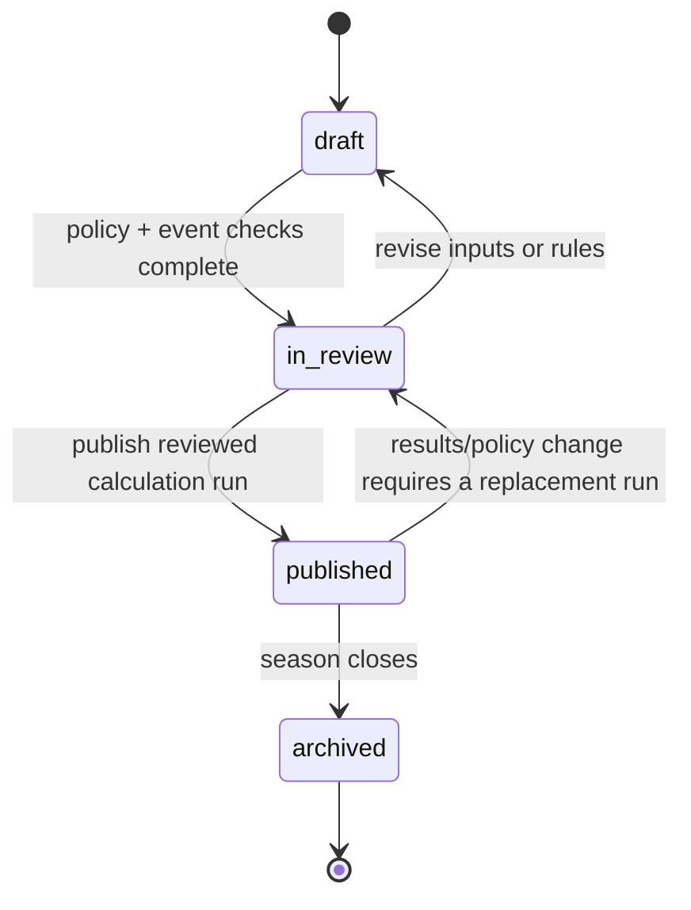
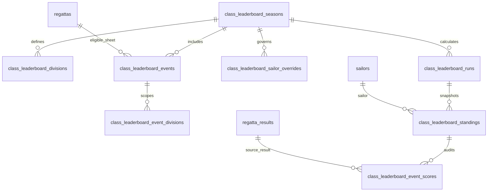

# Techno 293 seasonal leaderboard — database and admin-settings draft

**Status:** implementation-ready design draft; no seasonal-ranking policy is activated by this document.
**Scope:** Techno 293 only, using SailorPath’s canonical class-sheet result model.
**Owner:** superadmin-operated board & foil workflow.
**Primary decision:** a seasonal leaderboard is a separate, configured product from a regatta result, a Monsoon Grand Prix series, and the existing Optimist/ILCA national-ranking machinery.

---

## 1. Why a separate seasonal-leaderboard layer

The current data model has two distinct Techno 293 sources:

1. **Canonical sheets:** `regattas → regatta_results → regatta_race_results`. These are the source for future auditable leaderboard calculations.
2. **Legacy specialist scorecards:** `techno293_regattas.data` JSONB. These power historical scorecards and the existing Monsoon GP calculation, but lack canonical sailor/result identities and must **not** feed a new seasonal leaderboard directly.

> **Rule:** the seasonal leaderboard only reads published canonical Techno 293 class sheets. A legacy scorecard can be displayed publicly, but it is not a leaderboard input until explicitly reconciled into a canonical event, class sheet, sailor results, and race scores.

This avoids silently creating a ranking from names or scorecards that have not been matched to stable sailor IDs.

### Relationship to existing flags

Do **not** repurpose `regattas.counts_for_ranking` for this feature.

- Migration `103_remediate_public_class_policy.sql` explicitly sets Techno 293 sheets to `counts_for_ranking = false` because there is no approved platform-wide national-ranking policy today.
- The seasonal leaderboard must instead use a dedicated **season event-membership** record.
- A Techno 293 event can therefore be published as an official event result without being eligible for a particular season.

This preserves the current import guard and avoids accidentally admitting Techno results into Optimist/ILCA ranking calculations.

---

## 2. Product boundary and publication model

| Product | Source of truth | What it answers | Publication rule |
|---|---|---|---|
| Event results | Canonical class sheet | “What happened at this event?” | Class sheet is `published` |
| Monsoon GP series | Existing specialist scorecards / existing series logic | “Who leads this declared GP circuit?” | Existing series policy |
| **Techno 293 seasonal leaderboard** | Canonical seasonal configuration + canonical results | “Who leads this defined season under this declared policy?” | Published immutable calculation run |
| National ranking / selection | Not in this draft | “Who holds a federation national rank or selection place?” | Requires separately approved policy |

### Recommended lifecycle



- **Draft:** private administration and previews only.
- **In review:** configuration is complete; no public standings.
- **Published:** exactly one immutable published run is visible publicly. A later correction creates a replacement run; it never mutates a historic public run in place.
- **Archived:** historical record remains public, but configurations/events cannot be edited.

Public wording should use **“Techno 293 Seasonal Leaderboard”** and a visible label such as **Provisional** or **Official**, configured per season. It must not use “national ranking” or imply selection eligibility unless an approved policy explicitly changes that language.

---

## 3. Proposed PostgreSQL schema

The table names are generic enough to support a future iQFOiL season without a redesign, while initial validation limits `class_key` to `techno293`.

### 3.1 Entity overview



### 3.2 Core migration draft

> This is a SQL design draft, not a migration to run unchanged. The implementation migration should follow the repository’s numbered-migration convention and be reviewed against the current Supabase role/RLS setup.

```sql
BEGIN;

-- 1) One configured season for a class. Initially only Techno 293 is allowed.
CREATE TABLE public.class_leaderboard_seasons (
  id uuid PRIMARY KEY DEFAULT gen_random_uuid(),
  class_key text NOT NULL CHECK (class_key IN ('techno293')),
  season_key text NOT NULL,                       -- e.g. techno293-sg-2027
  season_year integer NOT NULL CHECK (season_year BETWEEN 2020 AND 2100),
  name text NOT NULL,                             -- e.g. 2027 Singapore Techno 293 Season
  public_title text NOT NULL,
  starts_on date NOT NULL,
  ends_on date NOT NULL,
  status text NOT NULL DEFAULT 'draft'
    CHECK (status IN ('draft', 'in_review', 'published', 'archived')),
  public_label text NOT NULL DEFAULT 'Provisional'
    CHECK (public_label IN ('Provisional', 'Official')),
  policy_version text NOT NULL,                   -- e.g. 2027.1
  policy_url text,
  public_policy_summary text NOT NULL,
  minimum_completed_races integer NOT NULL DEFAULT 3
    CHECK (minimum_completed_races >= 1),

  -- Immutable-by-version policy objects. Copy their exact values to every run.
  eligibility_config jsonb NOT NULL DEFAULT '{}'::jsonb,
  scoring_config jsonb NOT NULL DEFAULT '{}'::jsonb,
  tie_break_config jsonb NOT NULL DEFAULT '[]'::jsonb,

  published_run_id uuid,                          -- FK added after runs table
  created_by uuid REFERENCES public.profiles(id) ON DELETE SET NULL,
  updated_by uuid REFERENCES public.profiles(id) ON DELETE SET NULL,
  created_at timestamptz NOT NULL DEFAULT now(),
  updated_at timestamptz NOT NULL DEFAULT now(),

  CONSTRAINT class_leaderboard_seasons_dates_check CHECK (ends_on >= starts_on),
  CONSTRAINT class_leaderboard_seasons_class_key_uq UNIQUE (class_key, season_key)
);

-- 2) Display and eligibility divisions. Do not infer divisions from free text at render time.
CREATE TABLE public.class_leaderboard_divisions (
  id uuid PRIMARY KEY DEFAULT gen_random_uuid(),
  season_id uuid NOT NULL REFERENCES public.class_leaderboard_seasons(id) ON DELETE CASCADE,
  division_key text NOT NULL,                     -- open | u17 | u15 | women
  name text NOT NULL,
  short_label text NOT NULL,
  sort_order integer NOT NULL DEFAULT 0,
  status text NOT NULL DEFAULT 'active' CHECK (status IN ('active', 'inactive')),
  minimum_constituted_sailors integer NOT NULL DEFAULT 3
    CHECK (minimum_constituted_sailors >= 1),

  -- Example: {"resultDivisionAnyOf":["U17"],"genderAnyOf":["M","F"]}
  eligibility_rule jsonb NOT NULL DEFAULT '{}'::jsonb,
  created_at timestamptz NOT NULL DEFAULT now(),
  updated_at timestamptz NOT NULL DEFAULT now(),

  CONSTRAINT class_leaderboard_divisions_uq UNIQUE (season_id, division_key)
);

-- 3) A canonical Techno 293 class sheet admitted to a season.
CREATE TABLE public.class_leaderboard_events (
  id uuid PRIMARY KEY DEFAULT gen_random_uuid(),
  season_id uuid NOT NULL REFERENCES public.class_leaderboard_seasons(id) ON DELETE CASCADE,
  regatta_id uuid NOT NULL REFERENCES public.regattas(id) ON DELETE RESTRICT,
  status text NOT NULL DEFAULT 'candidate'
    CHECK (status IN ('candidate', 'eligible', 'excluded', 'locked')),
  event_weight numeric(6,3) NOT NULL DEFAULT 1.000
    CHECK (event_weight > 0),
  is_mandatory boolean NOT NULL DEFAULT false,
  inclusion_reason text,
  exclusion_reason text,
  reviewed_by uuid REFERENCES public.profiles(id) ON DELETE SET NULL,
  reviewed_at timestamptz,
  locked_at timestamptz,
  locked_by uuid REFERENCES public.profiles(id) ON DELETE SET NULL,
  created_at timestamptz NOT NULL DEFAULT now(),
  updated_at timestamptz NOT NULL DEFAULT now(),

  CONSTRAINT class_leaderboard_events_uq UNIQUE (season_id, regatta_id)
);

-- 4) Optional event-by-division scope. It lets a season include Open standings
--    from an event while excluding an incorrectly constituted U15 sub-fleet.
CREATE TABLE public.class_leaderboard_event_divisions (
  id uuid PRIMARY KEY DEFAULT gen_random_uuid(),
  leaderboard_event_id uuid NOT NULL
    REFERENCES public.class_leaderboard_events(id) ON DELETE CASCADE,
  division_id uuid NOT NULL
    REFERENCES public.class_leaderboard_divisions(id) ON DELETE CASCADE,
  is_eligible boolean NOT NULL DEFAULT true,
  source_division_rule jsonb NOT NULL DEFAULT '{}'::jsonb,
  reason text,
  created_at timestamptz NOT NULL DEFAULT now(),
  updated_at timestamptz NOT NULL DEFAULT now(),

  CONSTRAINT class_leaderboard_event_divisions_uq
    UNIQUE (leaderboard_event_id, division_id)
);

-- 5) Explicit, reviewed inclusion/exclusion decisions. This is the only place
--    an operator may override normal eligibility; every override needs a reason.
CREATE TABLE public.class_leaderboard_sailor_overrides (
  id uuid PRIMARY KEY DEFAULT gen_random_uuid(),
  season_id uuid NOT NULL REFERENCES public.class_leaderboard_seasons(id) ON DELETE CASCADE,
  division_id uuid NOT NULL REFERENCES public.class_leaderboard_divisions(id) ON DELETE CASCADE,
  sailor_id uuid NOT NULL REFERENCES public.sailors(id) ON DELETE RESTRICT,
  decision text NOT NULL CHECK (decision IN ('include', 'exclude', 'hold')),
  reason text NOT NULL,
  effective_from date,
  effective_to date,
  approved_by uuid REFERENCES public.profiles(id) ON DELETE SET NULL,
  approved_at timestamptz,
  created_by uuid REFERENCES public.profiles(id) ON DELETE SET NULL,
  created_at timestamptz NOT NULL DEFAULT now(),
  updated_at timestamptz NOT NULL DEFAULT now(),

  CONSTRAINT class_leaderboard_sailor_overrides_uq
    UNIQUE (season_id, division_id, sailor_id),
  CONSTRAINT class_leaderboard_sailor_overrides_dates_check
    CHECK (effective_to IS NULL OR effective_from IS NULL OR effective_to >= effective_from)
);

-- 6) A reproducible calculation snapshot. Preview runs are retained for audit
--    but only published_run_id is exposed to the public.
CREATE TABLE public.class_leaderboard_runs (
  id uuid PRIMARY KEY DEFAULT gen_random_uuid(),
  season_id uuid NOT NULL REFERENCES public.class_leaderboard_seasons(id) ON DELETE CASCADE,
  run_kind text NOT NULL CHECK (run_kind IN ('preview', 'publish', 'replacement')),
  status text NOT NULL DEFAULT 'queued'
    CHECK (status IN ('queued', 'running', 'completed', 'failed', 'superseded')),
  calculated_through date NOT NULL,
  algorithm_version text NOT NULL,                -- e.g. techno293-seasonal-v1
  input_hash text NOT NULL,                       -- hash of source IDs/timestamps + policy config
  policy_snapshot jsonb NOT NULL,
  diagnostics jsonb NOT NULL DEFAULT '{}'::jsonb,
  started_at timestamptz,
  completed_at timestamptz,
  generated_by uuid REFERENCES public.profiles(id) ON DELETE SET NULL,
  created_at timestamptz NOT NULL DEFAULT now(),

  CONSTRAINT class_leaderboard_runs_uq UNIQUE (season_id, input_hash)
);

-- 7) Immutable row per sailor/division in a completed run.
CREATE TABLE public.class_leaderboard_standings (
  id uuid PRIMARY KEY DEFAULT gen_random_uuid(),
  run_id uuid NOT NULL REFERENCES public.class_leaderboard_runs(id) ON DELETE CASCADE,
  division_id uuid NOT NULL REFERENCES public.class_leaderboard_divisions(id) ON DELETE RESTRICT,
  sailor_id uuid NOT NULL REFERENCES public.sailors(id) ON DELETE RESTRICT,
  standing_status text NOT NULL
    CHECK (standing_status IN ('ranked', 'insufficient_events', 'excluded', 'held')),
  rank integer,
  tie_group integer,
  score numeric(10,3),
  eligible_event_count integer NOT NULL DEFAULT 0,
  counted_event_count integer NOT NULL DEFAULT 0,
  attended_event_count integer NOT NULL DEFAULT 0,
  movement_from_published integer,
  explanation jsonb NOT NULL DEFAULT '{}'::jsonb,
  created_at timestamptz NOT NULL DEFAULT now(),

  CONSTRAINT class_leaderboard_standings_uq UNIQUE (run_id, division_id, sailor_id),
  CONSTRAINT class_leaderboard_standings_rank_check
    CHECK ((standing_status = 'ranked' AND rank IS NOT NULL AND score IS NOT NULL)
       OR (standing_status <> 'ranked'))
);

-- 8) The per-event calculation trail behind every standing.
CREATE TABLE public.class_leaderboard_event_scores (
  id uuid PRIMARY KEY DEFAULT gen_random_uuid(),
  standing_id uuid NOT NULL
    REFERENCES public.class_leaderboard_standings(id) ON DELETE CASCADE,
  leaderboard_event_id uuid NOT NULL
    REFERENCES public.class_leaderboard_events(id) ON DELETE RESTRICT,
  regatta_result_id uuid REFERENCES public.regatta_results(id) ON DELETE RESTRICT,
  finish_rank integer,
  eligible_fleet_size integer,
  source_nett_score numeric(10,3),
  base_points numeric(10,3),
  event_weight numeric(6,3) NOT NULL DEFAULT 1.000,
  weighted_points numeric(10,3),
  counts_toward_score boolean NOT NULL DEFAULT false,
  decision_code text,                             -- included | discard | dns | ineligible | override
  explanation text,
  created_at timestamptz NOT NULL DEFAULT now(),

  CONSTRAINT class_leaderboard_event_scores_uq UNIQUE (standing_id, leaderboard_event_id)
);

ALTER TABLE public.class_leaderboard_seasons
  ADD CONSTRAINT class_leaderboard_seasons_published_run_fk
  FOREIGN KEY (published_run_id)
  REFERENCES public.class_leaderboard_runs(id)
  ON DELETE SET NULL;

CREATE INDEX class_leaderboard_seasons_public_idx
  ON public.class_leaderboard_seasons(class_key, status, season_year DESC);
CREATE INDEX class_leaderboard_events_season_status_idx
  ON public.class_leaderboard_events(season_id, status);
CREATE INDEX class_leaderboard_runs_season_completed_idx
  ON public.class_leaderboard_runs(season_id, completed_at DESC);
CREATE INDEX class_leaderboard_standings_public_idx
  ON public.class_leaderboard_standings(run_id, division_id, rank);
CREATE INDEX class_leaderboard_event_scores_event_idx
  ON public.class_leaderboard_event_scores(leaderboard_event_id);

COMMIT;
```

### 3.3 Required database safeguards

| Safeguard | Enforcement | Reason |
|---|---|---|
| Canonical source only | `class_leaderboard_events.regatta_id` FK plus trigger | Prevents JSONB scorecards entering implicitly. |
| Techno 293 class match | `BEFORE INSERT OR UPDATE` trigger joins `regattas` and validates canonicalized `boat_class = techno293` | A cross-table rule cannot be expressed by a normal `CHECK`. |
| Published source sheet | Trigger or service validation requires `regattas.status = 'published'` before an event becomes `eligible` or `locked` | Draft/in-review results must not affect public standings. |
| Event readiness | Service validation requires configured race count, final result rows, and no unresolved duplicate/identity issues | Keeps ranking output explainable. |
| No global ranking side effect | Trigger rejects updates that set the source Techno sheet’s `counts_for_ranking = true` through this workflow | Preserves the current board/foil policy contract. |
| Reproducibility | `input_hash`, policy snapshot, result IDs, and per-event score rows are stored per run | A public historical standing can be re-explained later. |
| No silent correction | Published run is immutable; corrections create a `replacement` run and supersede the earlier one | Maintains an audit trail. |

### 3.4 Public projection and RLS

The public application should read a constrained view, not draft tables directly.

```sql
CREATE OR REPLACE VIEW public.published_techno293_leaderboard AS
SELECT
  season.id AS season_id,
  season.season_key,
  season.season_year,
  season.public_title,
  season.public_label,
  season.public_policy_summary,
  season.starts_on,
  season.ends_on,
  run.id AS run_id,
  run.calculated_through,
  division.division_key,
  division.name AS division_name,
  division.short_label,
  standing.rank,
  standing.score,
  standing.counted_event_count,
  standing.attended_event_count,
  sailor.id AS sailor_id,
  sailor.handle,
  sailor.name,
  sailor.board_number,
  sailor.club
FROM public.class_leaderboard_seasons season
JOIN public.class_leaderboard_runs run ON run.id = season.published_run_id
JOIN public.class_leaderboard_standings standing ON standing.run_id = run.id
JOIN public.class_leaderboard_divisions division ON division.id = standing.division_id
JOIN public.sailors sailor ON sailor.id = standing.sailor_id
WHERE season.class_key = 'techno293'
  AND season.status IN ('published', 'archived')
  AND run.status = 'completed'
  AND standing.standing_status = 'ranked';

GRANT SELECT ON public.published_techno293_leaderboard TO anon, authenticated, service_role;
```

RLS should mirror the established `regattas` pattern:

- `anon` and normal authenticated users: only the public projection / published rows.
- authenticated superadmins: full CRUD on all leaderboard tables.
- service role: unrestricted server-side calculation access.
- no direct public access to draft runs, raw diagnostics, event exclusions, or sailor override reasons.

### 3.5 Drizzle mapping

Add the five table groups above to `src/db/schema.ts`, with `jsonb`, `numeric`, UUID foreign keys, named unique constraints, and the indexes listed in the SQL. Keep the database table names and Drizzle exports aligned:

- `classLeaderboardSeasons`
- `classLeaderboardDivisions`
- `classLeaderboardEvents`
- `classLeaderboardEventDivisions`
- `classLeaderboardSailorOverrides`
- `classLeaderboardRuns`
- `classLeaderboardStandings`
- `classLeaderboardEventScores`

Do not add fields to `techno293Regattas`; that table remains a legacy specialist-scorecard compatibility store.

---

## 4. Policy configuration stored with each season

The policy must be explicit and versioned before the first public run. The schema deliberately stores the policy snapshot even if the UI renders it as forms.

### Example season configuration

```json
{
  "eligibility": {
    "sailorNationality": "all",
    "source": "published_canonical_techno293_class_sheets_only",
    "minimumCompletedRacesPerEvent": 3,
    "resultVerification": "admin_verified_or_published_import",
    "identityRequirement": "linked_sailor_id",
    "legacyScorecards": "never_implicit"
  },
  "scoring": {
    "method": "event_points_v1",
    "maximumCountedEvents": 4,
    "minimumCountedEventsToRank": 2,
    "mandatoryEventHandling": "must_count_when_completed",
    "eventWeights": "configured_per_event",
    "nonFinishHandling": "configured_in_points_schedule",
    "pointsSchedule": "federation-approved before publication"
  },
  "tieBreak": [
    "most_event_wins",
    "most_higher_event_finishes",
    "best_finish_at_latest_eligible_event",
    "shared_rank_if_still_tied"
  ]
}
```

### Required governance decision before implementation

The schema supports several formulas; it should **not** encode an unapproved one as a hidden default. The approving authority needs to select and publish exactly one:

| Option | Best fit | Caution |
|---|---|---|
| `event_points_v1` | A true cross-event seasonal leaderboard | Requires a published points schedule and DNS/DNF/DSQ treatment. |
| `event_low_point_v1` | A simple series with similar event formats | Different fleet sizes and event race counts can skew comparisons. |
| `circuit_race_low_point_v1` | A declared GP circuit under one NoR | Closest to existing Monsoon GP logic, but not a general season ranking. |

**Recommended administrative starting position:** create the schema and season shell now, then leave `status = draft` until the federation approves `policy_version`, the formula, the points/discard rules, and any nationality rule. This is more trustworthy than publishing an inferred national ranking.

---

## 5. Admin settings design

### 5.1 Navigation and ownership

Add a **Seasonal leaderboard** entry within the existing **Events → Board & foil classes → Techno 293** workflow.

Suggested route shape:

```text
/admin?area=events&view=board&class=techno293&panel=leaderboard
```

The dashboard’s existing Board & foil workspace remains the launch point. The legacy **Techno 293 Scorecards** view should not create seasons or season eligibility; it remains a compatibility editor only.

### 5.2 Season workspace tabs

| Tab | Main controls | Cannot do |
|---|---|---|
| **Overview** | season state, policy version, public title/label, calculated-through date, current published run | Change a published run’s rows in place |
| **Policy** | eligibility rules, minimum races, scoring model, best-events rule, tiebreak order, public policy summary | Select a scoring method without recording a policy version |
| **Divisions** | Open, U17, U15, Women; source matching rules; minimum constitution size | Infer division from a name-only legacy scorecard |
| **Eligible events** | candidate/eligible/excluded/locked class sheets; weights; mandatory flag; review reason | Toggle global `countsForRanking` |
| **Sailor decisions** | reviewed include/exclude/hold overrides, reason, effective period | Apply a reasonless exclusion |
| **Preview & checks** | calculation run, diagnostics, division table, score breakdown, diff from published run | Publish while blocking checks remain |
| **Publish & audit** | choose completed run, public label, change summary, superseded-run history | Delete published history |

### 5.3 Season form — required fields

| Field | Default | Validation |
|---|---|---|
| Season key | `techno293-sg-YYYY` | unique per class |
| Public title | `YYYY Singapore Techno 293 Seasonal Leaderboard` | required |
| Start / end date | admin-entered | end date cannot precede start date |
| Status | `draft` | only superadmin may transition |
| Public label | `Provisional` | `Official` requires a policy URL and review checklist |
| Policy version | `YYYY.1` | required before review/publish |
| Policy URL | blank | strongly required for `Official` |
| Minimum completed races | `3` | integer ≥1; not inherited from global ranking |
| Public policy summary | blank | required before publish |

### 5.4 Division settings

Create four inactive-by-default rows, then activate only the divisions that the approved policy supports:

| Division key | Display label | Suggested initial source rule |
|---|---|---|
| `open` | Open | every eligible canonical Techno result |
| `u17` | U17 | result/event division explicitly marked U17; do not guess from a name |
| `u15` | U15 | result/event division explicitly marked U15 |
| `women` | Women | verified result gender `F` or an explicit women’s fleet result |

Important constraints:

- `regatta_results` has `gender` and `birth_year`, but no current per-result Techno fleet-division column. The implementation needs an authoritative division source before U15/U17 can be published.
- Do not infer youth division from a sailor profile if the season policy says event entry division controls eligibility.
- Missing `gender`, DOB/birth year, or official division should yield a **blocking review queue**, not a guessed division.

### 5.5 Eligible-event settings

For every candidate canonical class sheet in the season dates, show:

- class sheet name, event date, venue, `boatClass`, division, lifecycle status;
- number of result rows, number of race-score rows, race count, unverified rows, and unmatched sailors;
- current eligibility state: **Candidate**, **Eligible**, **Excluded**, or **Locked**;
- event weight and mandatory-event setting;
- reviewed-by, review time, and required inclusion/exclusion reason.

A class sheet becomes **Eligible** only when all of these are true:

1. canonical boat class resolves to `techno293`;
2. sheet lifecycle is `published`;
3. race count meets the season rule;
4. all leaderboard candidates have a stable `sailor_id`;
5. result/race-score completeness passes the configured readiness rule;
6. any fleet/division mapping required by active season divisions is known;
7. a superadmin reviewed and saved the event decision.

Once a season is published, use **Locked** on every input event. Any correction must unlock via a logged action and culminate in a replacement calculation run.

### 5.6 Preview, calculation, and publication controls

**Calculation button:** `Generate preview`

It should:

1. validate all candidate event and sailor checks;
2. build an input hash from season config, event configuration, source result IDs, and source `updated_at` values;
3. create a preview run plus standings and per-event score breakdown;
4. show blockers separately from warnings;
5. compare the new preview with the current public run: entrants, rank movement, changed event contributions, and changed policy version.

**Publish button:** `Publish reviewed run`

Enable only if:

- season is `in_review`;
- selected run is `completed` and has no blockers;
- all included events are locked/reviewed;
- public policy summary and policy version are present;
- an audit confirmation includes the exact run, event count, division count, and public label.

Publication should atomically set `seasons.published_run_id`, move the season to `published`, mark a previous published run `superseded` when relevant, and write `admin_change_log` entries.

---

## 6. Calculation rules and auditability

### Inputs

Use only:

- `regattas` where canonicalized `boat_class = techno293` and `status = published`;
- the season’s `class_leaderboard_events` rows with `status IN ('eligible', 'locked')`;
- `regatta_results` tied to eligible sheets;
- `regatta_race_results` only when the configured formula requires race-level scoring;
- current sailor identity fields only for allowed eligibility rules;
- approved sailor overrides.

### Outputs stored for every run

For each standing, retain:

- public rank and tie group;
- total score and how many events were counted/attended;
- every eligible event’s final rank, source result ID, raw value, weight, calculated points, and include/discard decision;
- event, sailor, and policy exceptions with explanations;
- a calculation input hash and policy JSON snapshot.

This lets an admin answer: **“Why is this sailor third?”** without recomputing against possibly changed source data.

### Recalculation triggers

Mark the current published run as **stale** in the admin UI when any of the following happens after it was calculated:

- included class sheet lifecycle, race count, result row, or race score changes;
- sailor identity/gender/DOB data affects an active division;
- a leaderboard event weight/status changes;
- an override changes;
- policy/division settings change.

A stale run can remain historically visible, but the page should disclose its `calculated_through` date until a replacement run is published.

---

## 7. API and service boundaries

| Route | Audience | Purpose |
|---|---|---|
| `GET /api/leaderboards/techno293?season=...` | public | reads the published projection only |
| `GET /api/admin/leaderboards/seasons` | superadmin | season list and edit state |
| `POST /api/admin/leaderboards/seasons` | superadmin | create draft season |
| `PATCH /api/admin/leaderboards/seasons/:id` | superadmin | mutate draft/review settings with audit log |
| `POST /api/admin/leaderboards/seasons/:id/events` | superadmin | add/review canonical candidate event |
| `POST /api/admin/leaderboards/seasons/:id/runs` | superadmin | generate deterministic preview/publish run |
| `POST /api/admin/leaderboards/seasons/:id/publish` | superadmin | atomically publish selected reviewed run |

The calculation should live in a testable server-side domain module, for example:

```text
src/lib/leaderboards/techno293Seasonal.ts
```

It should not live inside the legacy `techno293Series.ts` module, because the latter calculates specialist scorecards/Monsoon circuits rather than canonical seasonal policy.

---

## 8. Implementation sequence

1. **Approve policy language first.** Confirm that this is a Techno 293 seasonal leaderboard, not a national-selection ranking; approve the scoring and eligibility policy version.
2. **Add migration and Drizzle schema.** Create tables, indexes, constraints, public view, RLS, and Techno class-sheet validation trigger.
3. **Build admin season shell.** Add overview, policy, division, and eligible-event tabs under Board & foil classes; keep it draft-only.
4. **Add result-readiness checks.** Require canonical identity, lifecycle, race count, division metadata, and complete result sources.
5. **Implement deterministic preview runs.** Add unit tests for points, discards, ties, exclusions, stale detection, and snapshot diffing.
6. **Add immutable publication workflow.** Publish a reviewed run, public API/view, and public leaderboard page with policy and event audit links.
7. **Pilot one season.** Seed no historical leaderboard automatically. Add only reviewed canonical sheets, compare preview to federation expectations, then publish as **Provisional**.
8. **Only then consider Official label.** Switch from Provisional only after the governing policy, event eligibility, and dispute/correction process are approved.

---

## 9. Acceptance criteria

### Database

- [ ] A season cannot contain a non-Techno or non-canonical source sheet.
- [ ] A Techno seasonal event does not change global `counts_for_ranking`.
- [ ] A published standing points to an immutable completed run.
- [ ] Every counted event score points to a canonical `regatta_result` or records why no result was used.
- [ ] Public users cannot read draft runs, overrides, or diagnostics.
- [ ] Every season/event/policy/publish change writes an admin audit record.

### Admin

- [ ] Superadmins can create and configure a draft season without exposing it publicly.
- [ ] The event picker explains every blocker and never offers a legacy JSONB scorecard as a direct input.
- [ ] Preview shows a full sailor/event score breakdown and a diff from the public run.
- [ ] Publish requires an explicit policy version, public summary, completed checks, and an immutable run.
- [ ] A correction creates a replacement run rather than editing historical standings.

### Public

- [ ] The page says **Seasonal Leaderboard**, status label, season dates, policy version, and calculated-through date.
- [ ] Each standing can show its counted events and score explanation.
- [ ] The page distinguishes event result, Monsoon GP series standing, and seasonal leaderboard.
- [ ] No copy refers to national ranking or selection unless a separately approved policy permits it.

---

## 10. Decisions needed from the federation / product owner

Before implementation moves beyond a draft season, resolve these policy choices:

1. Is the leaderboard open to all competitors at eligible Singapore events, or Singapore nationals only?
2. Does the season include both NE and SW Monsoon GP events, and any other named events?
3. Which scoring formula and points/discard table is official?
4. How many events must a sailor complete to receive a rank, and how many may count?
5. Are U15, U17, Women, and Open standings all official, and what is the authoritative source for division eligibility?
6. How are DNS, DNC, DSQ, OCS, RDG, event abandonment, and late corrections handled?
7. Who may approve publication and a replacement run, and what is the correction/dispute window?
8. Is this only a public season leaderboard, or may it later feed national selection? If selection is contemplated, it needs a separate policy and its own audit trail.

---

## Appendix: explicit non-goals for the first release

- No automatic conversion of legacy `techno293_regattas` JSONB scorecards into leaderboard inputs.
- No shared ranking across Techno 293, iQFOiL, or WingFoil.
- No changes to global Optimist/ILCA ranking calculations.
- No selection decisions, national squad invitations, or eligibility judgments.
- No public display of draft calculations or private override reasons.
